# Cem Deniz Demir

**Full-Stack Engineer** · Istanbul · open to work &amp; relocation

 **Frontend** — React, Next.js, Tailwind CSS 
 **UI design** — clean layouts, design systems, UX flows 
 **Backend** — Node.js, NestJS, REST &amp; GraphQL APIs 
 **Security** — auth, RBAC, OWASP-minded hardening 
 **Performance** — query tuning, caching, edge delivery 
 **DevOps** — Docker, CI/CD, cloud deploys

[Website](https://cemdenizdemir.com) · [LinkedIn](https://linkedin.com/in/cemdenizdemir) · [Email](mailto:cemdenizdemir@gmail.com)

 

###  What I can build

- **Auth & identity** — sign-in, sessions, OAuth/OIDC, roles and permissions
- **APIs & backends** — typed, validated, rate-limited services that stay easy to extend
- **Web apps** — fast, responsive products from database to UI
- **Internal tools** — admin panels, dashboards and automation pipelines

###  How I work

- **Secure by default** — validation, least privilege and auth tests from day one
- **Measure, then optimize** — query plans, payload size, cache hit rates
- **AI-assisted, with guardrails** — versioned prompts, isolated secrets

 <b>Toolbox</b>

 

- **Languages** — TypeScript, JavaScript, SQL, HTML, CSS
- **Backend** — Node.js, NestJS, Express, REST, GraphQL, tRPC
- **Frontend** — React, Next.js, Tailwind CSS, TanStack Query, Zustand
- **Data** — PostgreSQL, Prisma, Redis, MongoDB, MySQL
- **Security** — OAuth2/OIDC, JWT, Auth.js, argon2, Zod, rate limiting
- **Infra** — Docker, Kubernetes, GitHub Actions, AWS, Vercel, Cloudflare, Firebase
- **Testing** — Playwright, Jest

